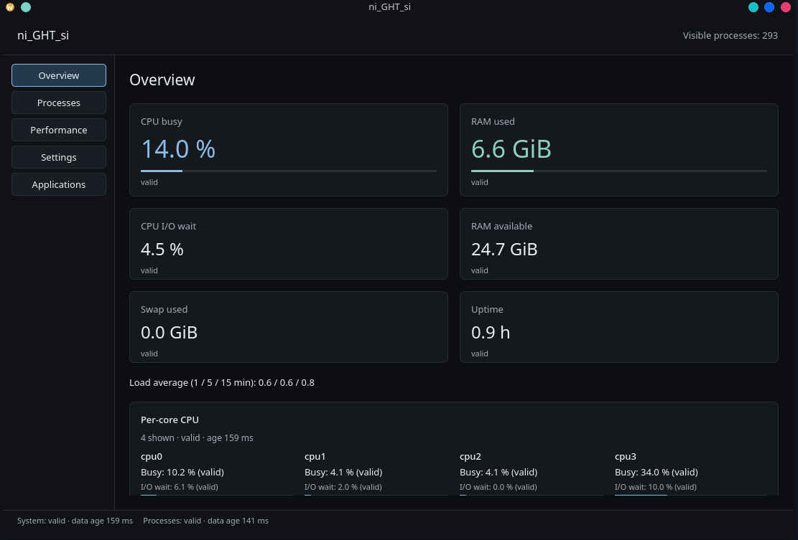
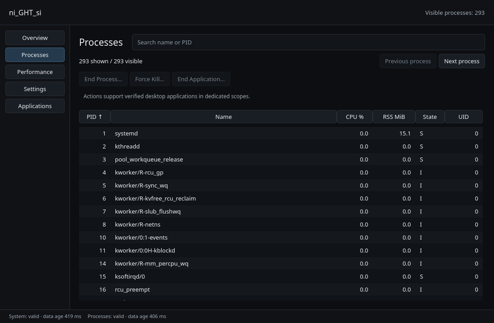
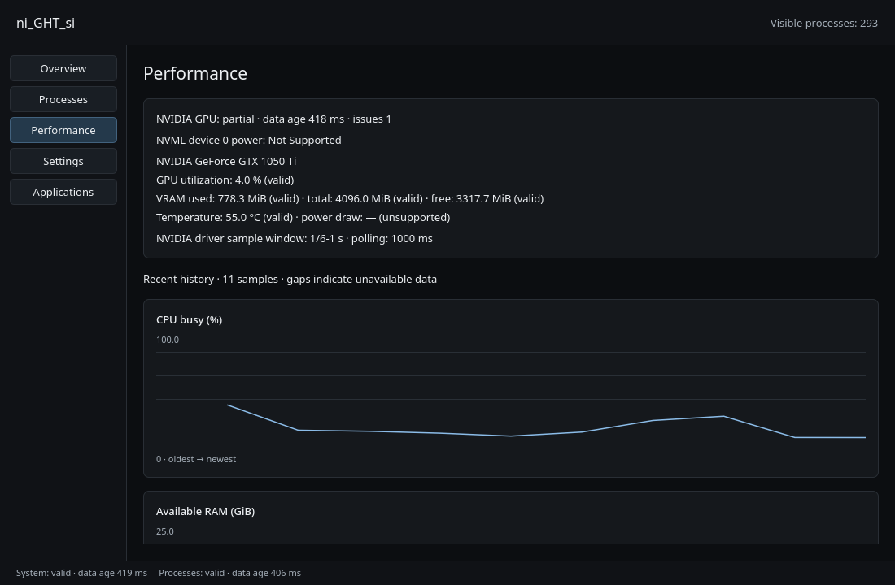
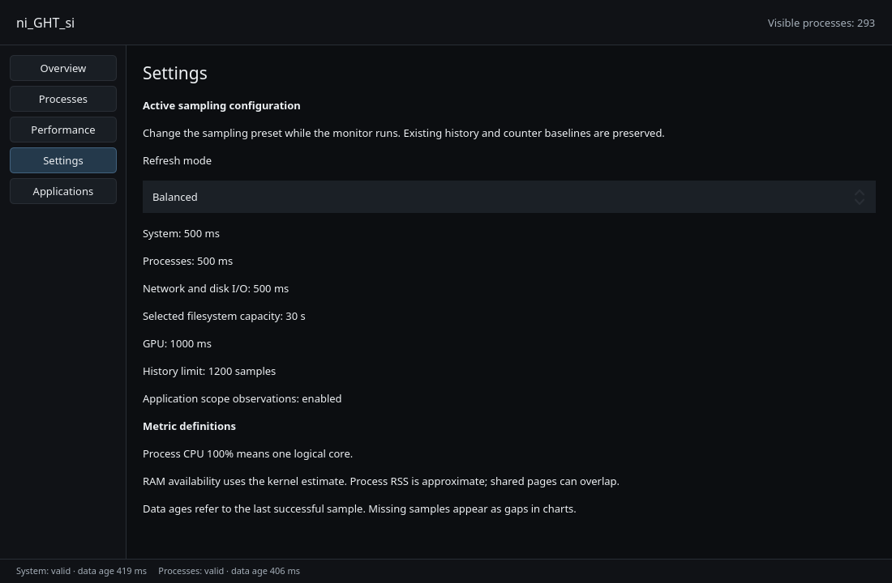
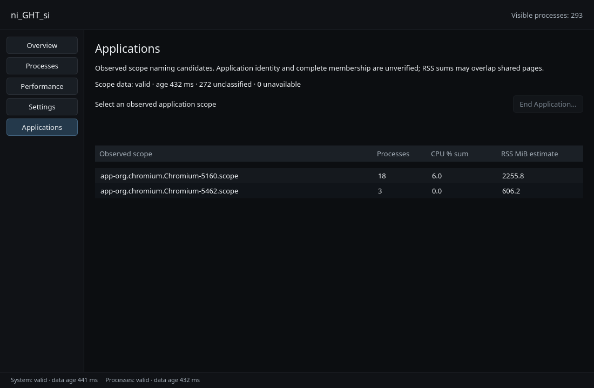

# ni_GHT_si

An experimental Linux system monitor and process manager built with **C++20, Qt 6 and QML**, primarily for Arch Linux and KDE Plasma.

The implementation combines a native desktop interface, background metrics collection, identity-checked process control and optional NVIDIA telemetry.

**v0.1.0 · Experimental · Unmaintained / Development Discontinued**  
Active development has ended. No further updates are currently planned by the maintainer.

## Features

- CPU, per-core usage, RAM, swap and bounded resource graphs.
- Process search, numeric sorting, selection and resource details.
- Confirmed SIGTERM and separately confirmed SIGKILL through retained pidfds.
- Conservative fixed-set End Application for supported desktop scopes.
- Network and whole-disk throughput, plus filesystem capacity.
- Optional NVIDIA utilization, VRAM and temperature; power where supported.
- Fast, Balanced and Low Power profiles, changeable while running.

## Screenshots

Overview



| Processes | Performance |
| --- | --- |
|  |  |

| Settings | Applications |
| --- | --- |
|  |  |

## Tech stack

C++20; Qt Quick/QML and Qt models; CMake/CTest; Linux procfs/sysfs, cgroup and pidfd APIs; optional dynamically loaded NVIDIA NVML. Metrics sampling runs independently of the interface.

## Requirements

Linux x86_64, a C++20 compiler, CMake 3.20+, and Qt 6.10+ Core, Gui, QML, Quick, Quick Controls 2 and DBus. Tests also require Qt Test; Wayland needs the Qt Wayland platform plugin. Tested on Arch Linux with KDE Plasma/Wayland and Qt 6.12.0.

Process actions additionally require pidfd support, cgroup v2, systemd user scopes and native D-Bus brokers with ProcessFD support. Unsupported or ambiguous targets remain protected.

## Build and run

```sh
cmake -S . -B build -DCMAKE_BUILD_TYPE=Release -DNIGHT_QT_UI=ON
cmake --build build --parallel 2
ctest --test-dir build --output-on-failure
./build/night-monitor
```

No system-wide installation is required. `--refresh-mode fast|balanced|low-power` selects a startup profile. GPU sampling is off by default; `--no-gpu` is also accepted. `--smoke` checks the interface without opening the GPU driver.

For NVIDIA support, configure with `-DNIGHT_NVML=ON` using an installed NVML SDK header, then run `./build/night-monitor --gpu`. The driver library is installed separately. Qt, NVIDIA headers and driver libraries are not bundled.

For a local installation, run `cmake --install build --prefix "$PWD/local-install"`.

## Verification

The release passed 27 CTest cases and seven targeted ASan/UBSan cases with leak detection disabled. Native Wayland interface checks, disposable-process action checks and extracted-package launch were verified. Tests that send signals use isolated disposable processes.

## Known limitations

- Performance is experimental; CPU, memory, startup and interaction targets have not been established.
- Process actions cover a narrow set of verified applications. Signals and observed exit are reported separately; fixed-set termination is not an atomic stop of changing application membership.
- GPU driver or kernel filesystem calls can delay shutdown. Unsupported sensors stay unavailable.
- Process RSS can overlap shared pages. Stacked disk/interface counters are not summed; partition throughput is unsupported.
- Long-duration soaks, physical-input latency and full screen-reader usability were not accepted. The binary archive requires compatible host libraries and QML plugins.

## License

Original project code is licensed under [MIT](LICENSE). Qt and NVIDIA materials retain their own terms; see [third-party notices](docs/THIRD_PARTY_NOTICES.md) and the included license texts.
