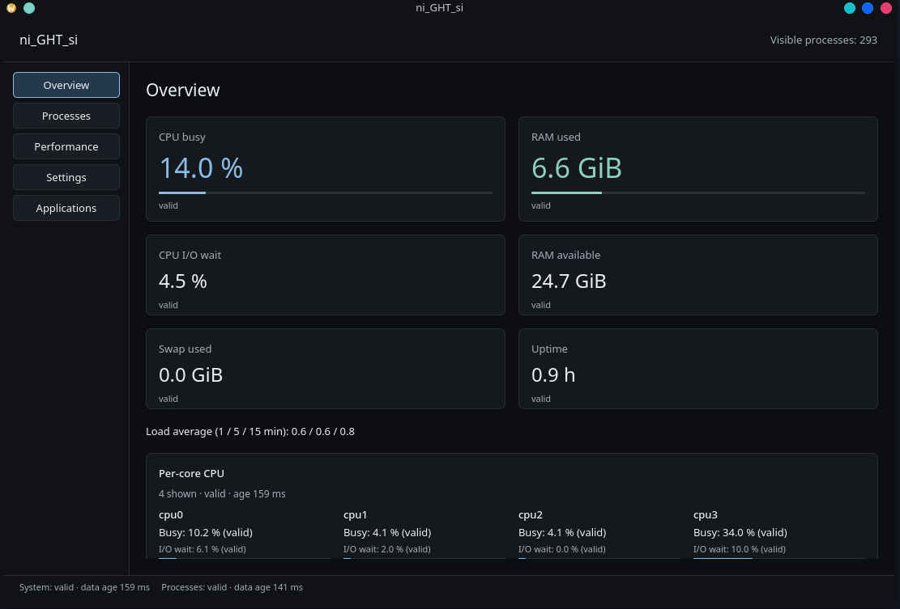

# ni_GHT_si v0.1.0 — Experimental Release

An experimental Linux system monitor and process manager built with C++20, Qt 6 and QML, tested on Arch Linux and KDE Plasma/Wayland.

## Included

CPU and memory graphs; process search, sorting and details; confirmed pidfd SIGTERM/SIGKILL actions; conservative fixed-set application termination; network, whole-disk and filesystem monitoring; live sampling profiles; optional NVIDIA telemetry.

The interface has a consistent near-black palette, compact tables and clearer CPU/RAM summaries. NVIDIA collection requires explicit `--gpu`; normal startup avoids its driver and worker.

## Screenshots

[Processes, Performance, Settings and Applications](README.md#screenshots)

## Verification

The NVIDIA-enabled Release build passed 27 CTest cases; seven targeted ASan/UBSan cases passed with leak detection disabled. Native Wayland interface/input checks and the real-manager fixed-set termination test passed using a disposable isolated application. Installed Qt/NVML libraries were not sanitizer-instrumented. These checks do not establish long-soak reliability, full screen-reader usability or the original performance targets.

## Known limitations

Performance targets are not established. Process actions deliberately reject unsupported launchers and ambiguous scopes. GPU or filesystem calls can delay shutdown; unavailable sensors remain unavailable. Screen-reader usability, physical-input latency and long soaks were not accepted. The x86_64 archive requires compatible host libraries and plugins.

## Development status

Development is discontinued by the original maintainer. No further releases are currently planned.
